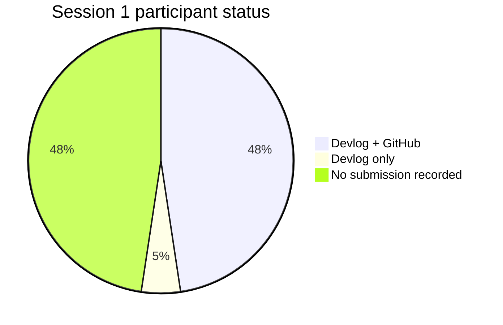
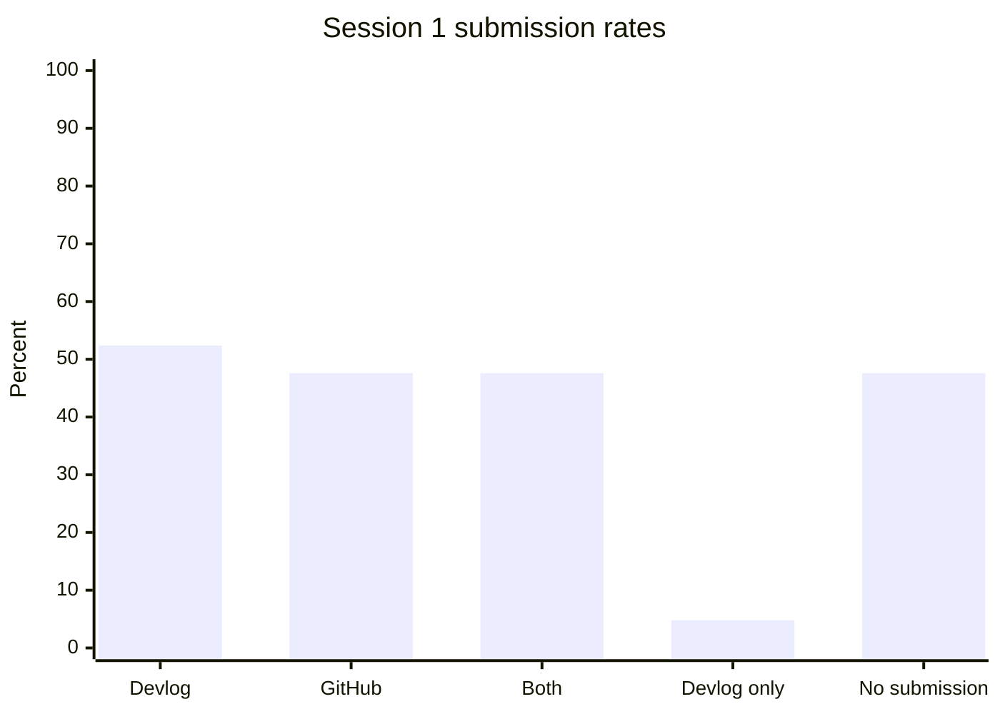

# BCP1 Bootcamp — Devlog & GitHub Reporting

**Reporting snapshot:** 21 October 2026  
**Scope:** BCP1 Bootcamp Phase 1, Sessions 1–7  
**Primary report:** [REPORT.md](./REPORT.md)

This repository contains the submission report built from the bootcamp tracking sheet and the GitHub links submitted by participants. It is designed for review and submission: the headline findings are visible here, while the full methodology and participant-level evidence are in [REPORT.md](./REPORT.md).

## Headline Results

| KPI | Result |
|---|---:|
| Participants | 21 |
| Session 1 devlogs | 11 / 21 (52.4%) |
| Session 1 GitHub links | 10 / 21 (47.6%) |
| Submitted both devlog and GitHub | 10 / 21 (47.6%) |
| Devlog only | 1 / 21 (4.8%) |
| No submission recorded | 10 / 21 (47.6%) |
| Artifact completion | 21 / 42 (50.0%) |
| Observed commits across linked targets | 43 |

## Files

- [International report](./REPORT.md)
- [Interactive HTML report](./BCP1_bootcamp_devlog_report.html)
- [Excel workbook with dashboard and charts](./BCP1_bootcamp_devlog_report.xlsx)
- [GitHub evidence snapshot](./github_evidence.json)

## Data Note

The source sheet contains submission data for Session 1. Sessions 2–7 have a defined curriculum, but their submission fields are not populated in the snapshot. This report records those sessions as `N/A`; it does not treat missing rows as proof that no activity occurred.
