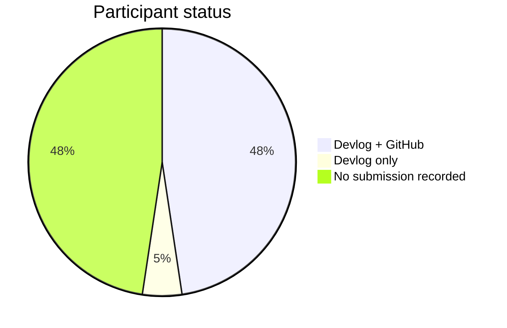
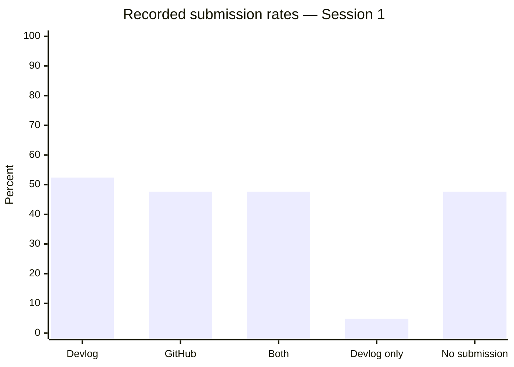

# BCP1 Bootcamp — Devlog & GitHub Submission Report

**Document status:** Submission-ready snapshot  
**Reporting date:** 21 October 2026  
**Timezone:** Asia/Saigon (GMT+7)  
**Coverage:** BCP1 Bootcamp Phase 1, Sessions 1–7

## 1. Executive Summary

This report evaluates the recorded devlog and GitHub submissions for the BCP1 Bootcamp cohort using the tracking sheet and the GitHub links entered by participants.

At the reporting snapshot:

- The cohort contains **21 participants**.
- Session 1 has **11 devlogs** and **10 GitHub links** recorded.
- **10 participants** submitted both required artifacts.
- **1 participant** submitted a devlog without a GitHub link.
- **10 participants** have no submission recorded in the source sheet.
- The resulting artifact completion rate is **21 / 42 = 50.0%**.
- The linked GitHub targets contain **43 observed commits** in total. This is an activity trace, not a quality score.

The source sheet contains populated submission fields for Session 1 only. Sessions 2–7 are reported as `N/A` where no submission data is present.

## 2. Sources and Scope

| Source | Use |
|---|---|
| [Bootcamp tracking Google Sheet](https://docs.google.com/spreadsheets/d/1HKSoMEhSCYqL6Py5u5LB1rrh9yxlXRT-vgjRrb2HBW8/edit?gid=1890794766) | Participant roster, submission flags, session plan, completion percentages |
| [Participant GitHub links](https://github.com/Blockchain-Pioneer-Student/BCP1-Devlog-Summarize/blob/main/github_evidence.json) | Repository/file validation and commit-history evidence |
| [HTML report](./BCP1_bootcamp_devlog_report.html) | Printable visual report |
| [Excel workbook](./BCP1_bootcamp_devlog_report.xlsx) | Dashboard, formulas, tables and charts |

The report was generated from a snapshot taken on **21 October 2026**. No credentials, SSH keys or access tokens are stored in this repository.

## 3. Methodology

1. Read the participant roster and submission flags from the source sheet.
2. Classified each participant as `Devlog + GitHub`, `Devlog only`, or `No submission`.
3. Checked each submitted GitHub URL against the linked repository or file.
4. Counted commits returned for the linked file path; for the one repo-level URL, the repository-level history is reported and is explicitly marked as repo-level evidence.
5. Converted GitHub timestamps to GMT+7 for the participant register.
6. Left unpopulated sessions as `N/A` instead of inferring a zero.

## 4. KPI Dashboard

| Metric | Count | Rate |
|---|---:|---:|
| Participants | 21 | 100.0% |
| Devlog submitted | 11 | 52.4% |
| GitHub link submitted | 10 | 47.6% |
| Both artifacts submitted | 10 | 47.6% |
| Devlog only | 1 | 4.8% |
| No submission recorded | 10 | 47.6% |
| Expected artifacts | 42 | 100.0% |
| Recorded artifacts | 21 | 50.0% |
| Average completion per participant (source sheet) | — | 7.1% |
| Observed commits across linked targets | 43 | — |

## 5. Session Timeline and Data Availability

| Session | Topic | Scheduled date | Presenter | Submission data in snapshot | Devlog | GitHub | Artifact rate |
|---:|---|---|---|---|---:|---:|---:|
| 1 | Blockchain Fundamentals | 14 Oct 2026 | Hoang Phong | Observed | 11 / 21 | 10 / 21 | 50.0% |
| 2 | How Blockchain Works | 21 Oct 2026 | Hoang Phong | N/A | N/A | N/A | N/A |
| 3 | Cryptography & Wallet | Not scheduled in source | Ngô Văn Tuân | N/A | N/A | N/A | N/A |
| 4 | Consensus & Blockchain Architecture | Not scheduled in source | Ngô Văn Tuân | N/A | N/A | N/A | N/A |
| 5 | Smart Contracts & Digital Assets | Not scheduled in source | Trần Hữu Hưng | N/A | N/A | N/A | N/A |
| 6 | DApps & Web3 Ecosystem | Not scheduled in source | Trần Hữu Hưng | N/A | N/A | N/A | N/A |
| 7 | Practice + AMA | Not scheduled in source | Cả 3 | N/A | N/A | N/A | N/A |

## 6. Participant Register

`Commit window` is the first-to-latest observed commit date for the linked target, shown in GMT+7. A dash means that no GitHub target was recorded in the source sheet.

| # | Participant | Devlog | GitHub | Source completion | Repository | Observed commits | Commit window |
|---:|---|:---:|:---:|---:|---|---:|---|
| 1 | Lê Ngọc | Yes | Yes | 14% | [ngocngoc000-jpg/Blockchain-01](https://github.com/ngocngoc000-jpg/Blockchain-01) | 14 | 2026-10-20 → 2026-10-20 |
| 2 | Đỗ Duy Hiếu | Yes | Yes | 14% | [dhyeu04/dev-lock-bootcamp](https://github.com/dhyeu04/dev-lock-bootcamp) | 4 | 2026-10-20 → 2026-10-20 |
| 3 | Nguyễn An Dương | No | No | 0% | — | 0 | — |
| 4 | Lê Hoàng Linh | Yes | Yes | 14% | [luckylinhle110297-prog/L-Ho-ng-Linh-bootcamp](https://github.com/luckylinhle110297-prog/L-Ho-ng-Linh-bootcamp) | 2 | 2026-10-20 → 2026-10-20 |
| 5 | CHU AN BÌNH | Yes | Yes | 14% | [AnBinhChu/Bu-i-1-Blockchain-Fundamentals](https://github.com/AnBinhChu/Bu-i-1-Blockchain-Fundamentals) | 4 | 2026-10-18 → 2026-10-20 |
| 6 | Vũ Trung Hiếu | Yes | Yes | 14% | [trghieu03/bootcamp-devlog](https://github.com/trghieu03/bootcamp-devlog) | 2 | 2026-10-21 → 2026-10-21 |
| 7 | Chu Thị Hương | Yes | Yes | 14% | [huoniie/dev-lock-bootcamp](https://github.com/huoniie/dev-lock-bootcamp) | 9 | 2026-10-19 → 2026-10-20 |
| 8 | Trần Đình Nam | No | No | 0% | — | 0 | — |
| 9 | Nguyễn Anh Tuấn | No | No | 0% | — | 0 | — |
| 10 | Nguyễn Anh Khôi | No | No | 0% | — | 0 | — |
| 11 | Nguyễn Minh Hiếu | Yes | Yes | 14% | [MynameisHiu/Dev-Log-bootcamp](https://github.com/MynameisHiu/Dev-Log-bootcamp) | 2 | 2026-10-20 → 2026-10-20 |
| 12 | Nguyễn Anh Khoa | No | No | 0% | — | 0 | — |
| 13 | Phạm Tuấn Kiệt | No | No | 0% | — | 0 | — |
| 14 | Thân Gia Khánh | No | No | 0% | — | 0 | — |
| 15 | Nguyễn Xuân Đại | Yes | Yes | 14% | [dainx06/dev-lock-bootcamp](https://github.com/dainx06/dev-lock-bootcamp) | 3 | 2026-10-21 → 2026-10-21 |
| 16 | Phạm Văn Giáp | No | No | 0% | — | 0 | — |
| 17 | Bùi Minh An | No | No | 0% | — | 0 | — |
| 18 | Nguyễn Anh Tuấn | Yes | Yes | 14% | [Tuan2K7/dev-lock-bootcamp](https://github.com/Tuan2K7/dev-lock-bootcamp) | 1 | 2026-10-14 → 2026-10-14 |
| 19 | Nguyễn Phương Thảo | No | No | 0% | — | 0 | — |
| 20 | Ánh | Yes | No | 7% | — | 0 | — |
| 21 | Bảo Khanh | Yes | Yes | 14% | [khanhnguyeenx-vie/dev-lock-bootcamp](https://github.com/khanhnguyeenx-vie/dev-lock-bootcamp) | 2 | 2026-10-20 → 2026-10-20 |

## 7. GitHub Evidence Audit

The source sheet contains 10 GitHub links. Nine are file-level links that returned HTTP 200 for the referenced `session-01.md` file. One is a repository-level link and is not treated as a file-level confirmation.

| Participant | Evidence type | Repository | Result | Observed commits |
|---|---|---|---|---:|
| Lê Ngọc | File link | [Blockchain-01](https://github.com/ngocngoc000-jpg/Blockchain-01) | HTTP 200 | 14 |
| Đỗ Duy Hiếu | File link | [dev-lock-bootcamp](https://github.com/dhyeu04/dev-lock-bootcamp) | HTTP 200 | 4 |
| Lê Hoàng Linh | File link | [L-Ho-ng-Linh-bootcamp](https://github.com/luckylinhle110297-prog/L-Ho-ng-Linh-bootcamp) | HTTP 200 | 2 |
| CHU AN BÌNH | File link | [Bu-i-1-Blockchain-Fundamentals](https://github.com/AnBinhChu/Bu-i-1-Blockchain-Fundamentals) | HTTP 200 | 4 |
| Vũ Trung Hiếu | File link | [bootcamp-devlog](https://github.com/trghieu03/bootcamp-devlog) | HTTP 200 | 2 |
| Chu Thị Hương | File link | [dev-lock-bootcamp](https://github.com/huoniie/dev-lock-bootcamp) | HTTP 200 | 9 |
| Nguyễn Minh Hiếu | File link | [Dev-Log-bootcamp](https://github.com/MynameisHiu/Dev-Log-bootcamp) | HTTP 200 | 2 |
| Nguyễn Xuân Đại | File link | [dev-lock-bootcamp](https://github.com/dainx06/dev-lock-bootcamp) | HTTP 200 | 3 |
| Nguyễn Anh Tuấn | Repo link | [dev-lock-bootcamp](https://github.com/Tuan2K7/dev-lock-bootcamp) | Repo exists; link is not file-level | 1 |
| Bảo Khanh | File link | [dev-lock-bootcamp](https://github.com/khanhnguyeenx-vie/dev-lock-bootcamp) | HTTP 200 | 2 |

## 8. Findings

1. **Submission coverage is uneven.** Devlog coverage is higher than GitHub-link coverage by 4.8 percentage points (11 versus 10 participants).
2. **Most recorded devlogs have a corresponding GitHub link.** Ten of the eleven devlog submitters also have a GitHub link in the sheet.
3. **The current snapshot is Session 1-heavy.** The source structure defines seven sessions, but only Session 1 has populated submission metrics.
4. **Commit counts are evidence, not assessment.** A higher commit count can reflect editing style, repository history or synchronization; it is not a grading metric.

## 9. Limitations and Data Quality

- Blank submission fields for Sessions 2–7 are reported as `N/A`, not as zero.
- The GitHub audit validates the URLs and available history at snapshot time; it does not grade content correctness.
- The repo-level link for Nguyễn Anh Tuấn does not identify a student-specific `session-01.md` file.
- Participant names and Discord names are reproduced from the source sheet; no additional identity data was inferred.

## 10. Reproducibility

The repository includes:

- `BCP1_bootcamp_devlog_report.xlsx` — formula-based workbook and charts.
- `BCP1_bootcamp_devlog_report.html` — printable visual report.
- `github_evidence.json` — GitHub evidence snapshot used for the audit.

The report should be regenerated after the tracking sheet is updated with Sessions 2–7 submissions.
